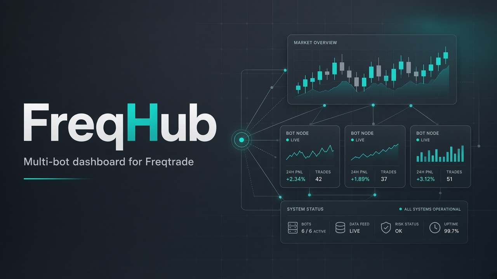

<!--
 * FreqHub - Multi-bot dashboard for Freqtrade
 * Copyright (C) 2025 - 2026  FreqHub Contributors
 * SPDX-License-Identifier: GPL-3.0-or-later
 -->

<div align="center">

# FreqHub

**One dashboard. Many Freqtrade bots.**

[](https://github.com/hrodrig/freqhub/actions/workflows/ci.yml)
[](https://github.com/hrodrig/freqhub/releases)
[](https://www.gnu.org/licenses/gpl-3.0)
[](https://nodejs.org/)
[](https://www.typescriptlang.org/)
[](https://react.dev/)
[](https://hub.docker.com/)
[](CONTRIBUTING.md)

[Quick start](#-quick-start) · [Docs](docs/README.md) · [Changelog](CHANGELOG.md) · [Issues](https://github.com/hrodrig/freqhub/issues)

<br />



</div>

---

## The problem

[FreqUI](https://github.com/freqtrade/frequi) is excellent for a **single** bot. Running several strategies (dry + live, K8s pods, Docker Compose stacks) means many tabs, scattered credentials, and no shared view of profit, alerts, or controls.

## The solution

**FreqHub** is a multi-bot control plane for [Freqtrade](https://github.com/freqtrade/freqtrade):

- Secure backend stores encrypted bot credentials (SQLite)
- Proxies Freqtrade APIs (no browser CORS maze)
- Unified React dashboard: status, trades, comparison, backtests, alerts
- Realtime via Valkey/Redis cache, event bus, and WebSockets
- Built for Docker and Kubernetes (configurable base path)

Extra strategies: [freqhub-strategies](https://github.com/hrodrig/freqhub-strategies).

> **Alpha** — early development; APIs may change. Not production-hardened for every deployment. Read the [disclaimer](docs/disclaimer.md).

## Table of contents

- [The problem](#the-problem)
- [The solution](#the-solution)
- [Features](#-features)
- [Quick start](#-quick-start)
- [Documentation](#-documentation)
- [What's new](#-whats-new)
- [Contributing](#-contributing)
- [License](#-license)
- [Support](#-support)

## Features

| Area | Highlights |
|------|------------|
| **Multi-bot** | Connect many Freqtrade APIs; aggregate dashboard + per-bot views |
| **Security** | Encrypted credentials, JWT auth, RBAC, audit log |
| **Realtime** | Valkey cache, polling, WebSocket pushes, online/offline events |
| **Ops** | Rate limits toward bots, base-path / Ingress friendly, Docker images |
| **Trading UX** | Trade management, bot comparison, backtest comparison, alerts |

Roadmap leftovers: 2FA/TOTP, richer audit UI. Details in [docs](docs/README.md).

<p align="right"><a href="#freqhub">⬆ back to top</a></p>

## Quick start

**Users (published images):**

```bash
docker compose -f docker-compose.published.yml up -d
```

**Developers:**

```bash
./freqhub setup
./freqhub dev-bots    # Valkey + sample bots
./freqhub dev         # API :3001 + UI :3000
```

Full install, env, Valkey, and build notes → **[Getting started](docs/getting-started.md)**.

<p align="right"><a href="#freqhub">⬆ back to top</a></p>

## Documentation

| Topic | Link |
|-------|------|
| Getting started (Docker / local / CLI) | [docs/getting-started.md](docs/getting-started.md) |
| Configuration & env | [docs/configuration.md](docs/configuration.md) · [ENV_SETUP.md](ENV_SETUP.md) |
| Auth, RBAC, audit | [docs/authentication.md](docs/authentication.md) |
| Adding bots & URLs | [docs/usage.md](docs/usage.md) |
| Architecture | [docs/architecture.md](docs/architecture.md) |
| Health / WS / polling tests | [docs/testing.md](docs/testing.md) |
| Risk disclaimer | [docs/disclaimer.md](docs/disclaimer.md) |
| Deploy examples | [examples/docker](examples/docker/) · [examples/kubernetes](examples/kubernetes/) |

<p align="right"><a href="#freqhub">⬆ back to top</a></p>

## What's new

**[v0.2.24](CHANGELOG.md#0224---2026-10-10)** — Bot comparison, trade management, backtest comparison, alerts; dashboard/Live fixes; `xlsx` → exceljs; alert ownership + scoped WS; CI + SECURITY / CONTRIBUTING / CODEOWNERS.

Older notes: [CHANGELOG.md](CHANGELOG.md).

<p align="right"><a href="#freqhub">⬆ back to top</a></p>

## Contributing

See **[CONTRIBUTING.md](CONTRIBUTING.md)**. Also: [Code of Conduct](CODE_OF_CONDUCT.md), [Security policy](SECURITY.md).

## License

[GNU GPL v3](LICENSE) — Copyright (C) 2025–2026 FreqHub Contributors.

## Support

- [Issues](https://github.com/hrodrig/freqhub/issues)
- [Discussions](https://github.com/hrodrig/freqhub/discussions)
- [Donations](DONATIONS.md)

---

FreqHub is independent and not officially affiliated with Freqtrade.

<p align="right"><a href="#freqhub">⬆ back to top</a></p>
